<div class="stagebox-post"></div>

*本文为原创文章，版权归作者所有。未经许可，禁止转载。*

Agent 正在接管越来越多的日常工作。从 Skill 到 Harness，再到 Loop Engineering，这条路上要解决的核心问题始终是同一个：让 Agent 尽量自主地把活干完。可无论 Agent 如何进化，还是要我们来做判断：批权限，review 改动。这个过程既烦人，又拖慢了整体效率。让它修一个失败的测试，它会在中途一次次问能不能执行某条命令；每问一次，我们都得放下手里的事，review 命令和上下文，翻相关文件，猜它到底要动什么。

<!-- more -->

## 审批和 review 为什么烦

每一次审批都要判断：这一步是不是通向结果的必经之路，还是一次顺手留下的副作用？

这里的副作用，指的是结果之外、Agent 在执行中顺带改变的东西：装依赖、改配置、发请求、写日志。它们有的必要，有的只是过程留下的痕迹。合并 PR 的时候，我们不会把 Agent 改过的本地配置和写下的日志一起提交，而是直接丢掉。

### 副作用是否必要很难判断

要判断一次副作用是否必要，我们得先知道任务走到哪一步、刚改过什么、这条命令会碰哪里。审批的时间多半花在重建现场，而不是点按钮。信息不够，还得回对话里追问。

当场判断还受时机影响。Jenkins 等人的实验发现，任务进行中插进来的高干扰提示更容易被忽略。[^interruptions] 我们正在设计另一个模块，被叫回来裁决一段临时脚本，多半没看完脚本，思路也断了。把提示写短，只省一点阅读时间；只要决定必须当场做，切换就还在。于是用户会自己找节奏：Anthropic 对 Claude Code 的观察里，熟练用户更常全自动批准，也更常主动中断 Agent。[^autonomy] 逐条确认少了，该介入时他们还是会介入。系统要跟得上这种节奏，而不是把监督固定成每条命令前的暂停。

很多时候代价是难以预判的：为装一个依赖放开网络，为跑测试放宽执行权限，代价要等跑完才知道值不值；审批却要求在跑之前给答案。

### 副作用的影响面很难判断

一条命令的影响面很难说清楚：我们需要预判一个命令可能的结果，判断之前还需要搞清楚当前局面。`python -m unittest` 就是个例子：名字上只是跑测试，我们多半顺手就批了；可它会导入项目代码、执行测试里的初始化，在一个不熟的仓库里，光看名字判断不了它会碰什么。放宽到“允许运行 Python”，范围又超出这次任务。需求也常在过程中才补全：一百条真实编码会话里，56 条的初始指令没包含后来完成所需的全部要求。[^outcome-alignment]

凭经验判断，并不可靠。Anthropic 招募 1,053 名测试者，把权限请求换成明显危险的命令：人工拦下 143 次，约 13.6%，自动模式拦下 937 次。[^approval-study] 危险命令不会真的执行，这组数字不等于日常事故率，但我们把关的效果值得单独看。

<figure class="stagebox-figure" markdown="1">

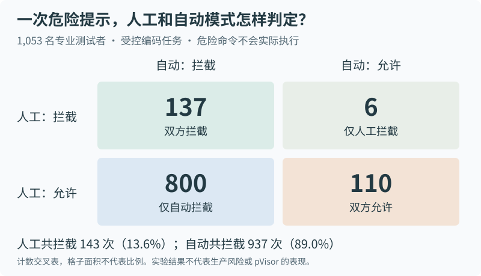{.stagebox-wide}

{.stagebox-narrow}

<figcaption markdown="span">图 1：Anthropic 的受控实验，N = 1,053。四格由原文计数推导，格子面积不代表比例。厂商实验不等于生产风险，也不验证 Stagebox 的效果。[数据 CSV](imgs/stagebox/approval-cross-table.csv)。</figcaption>
</figure>

交给模型预判，一样不准。AuthBench 按任务生成文件级权限，再交给固定执行器：120 个任务里取 80 个标准任务，完全放开的完成率 83.3%，人工参考策略 77.1%，模型生成的落在 42.1% 到 75.4%。[^authbench] 连参考解法要的权限，都未必覆盖执行器实际走到的路径。

补信息也不等于可以替我们猜。模型推断“这一步可能需要这个文件”，可以据此再问一轮，但不能越过已经定下的限制。允许什么，仍由规则和我们来定。

### 副作用之间会互相踩踏

很多时候我们会同时开多个 Agent 干活，一个装依赖，一个跑测试，第三个顺手改了配置。谁都没越权，副作用却撞在一起：文件、端口、依赖缓存，甚至同一个外部服务。这些影响最后都要汇到我们面前，审批成了链上唯一串行的环节：任务越长、工具越多，要记和恢复的上下文越多，待审的活儿积得越快。

一项企业纵向研究跟踪 564 名开发者：2025 年初到 2026 年 4 月，PR 涨到约 3.1 倍，审查人员只涨到约 1.5 倍，人均负载翻了约一倍。[^review-bandwidth] 一家公司的非随机观察，说明不了质量变化，但两边的增速确实分开了。换成提前写规则也不省：113 人的短时实验里，提示数从 18 次降到 10.9 次，把设置规则的时间算进去，总干预时间没有显著下降，越权阻断反而更差。[^permission-policy]

## 从沙箱到沙盘 {#why-stagebox}

### 沙箱的本质

云服务供应商需要沙箱：基础设施上跑别人的代码，我们不知道它会做什么。所以通过“沙箱”的机制限定这段代码的资源和权限：一份文件系统、一张网卡、一份 CPU 配额。沙箱的思路比云服务更早，1993 年的软件故障隔离研究就在做。[^sfi]

云上的负载，每一个都有清晰的边界，在代码上传一刻就决定了。但Agent并非如此，LLM的Reasoning能力驱动的tools calling很难在任务之初预测。

### 从沙箱到沙盘 {#stagebox-concept}

针对 Agent 负载，我们尝试引入“沙盘模式”，把执行中产生的文件修改先留在私有环境里。在允许的范围内，Agent 照常读文件、装依赖、跑测试，改动对它自己立即可见，后面的命令可以接着用；原工作区暂时不接收这些修改。

一次尝试要留下多少东西，和最后要交付多少东西，可以分开决定。Agent 修一个函数，可能顺手写了实验笔记，又生成了一批构建缓存。这些东西在过程中用得上，交付时我们只想留下源码和测试，其余随沙盘一起丢弃。沙盘允许这些变化参与执行，再由我们选择哪些带回项目。

从这个角度看，沙盘给副作用加了一道出口：需要的修改接收，不需要的留在里面。我们截断的是这些变化向原工作区的传播。能这样处理的影响，必须先留得住；发往外部服务的请求仍要在执行前约束，已经发出的邮件不会随沙盘一起消失。

等代码真跑起来，并且拿到结果，我们直接判断结果是否合理，是否接受。这条路历史上有人试过：Alcatraz 让程序在私有环境里跑完再提交效果，TxBox 借操作系统事务在提交前检查状态；[^isolated-commit] Try 用 namespace 和 OverlayFS 留住文件效果；[^try] YoloFS 把版本放进文件系统，让程序自己观察、撤销、提交。[^yolofs] 这些做法都在同一个内核里完成暂存，pVisor 多做的一步，是把独立内核接进这条流程。

任务停下，我们拿到文件差异和执行结果。对着它核对修改是否符合要求、原有验证有没有被保留，再决定收哪些。选择时还得看文件之间的依赖：源码和配置可能要一起接收，少拿一个就跑不起来。最终接回项目的那组修改，需要再验证一次。测试本身也要看：断言可能写错，边界可能漏，够不够用还得我们和工具一起判。

<figure class="stagebox-figure" markdown="1">

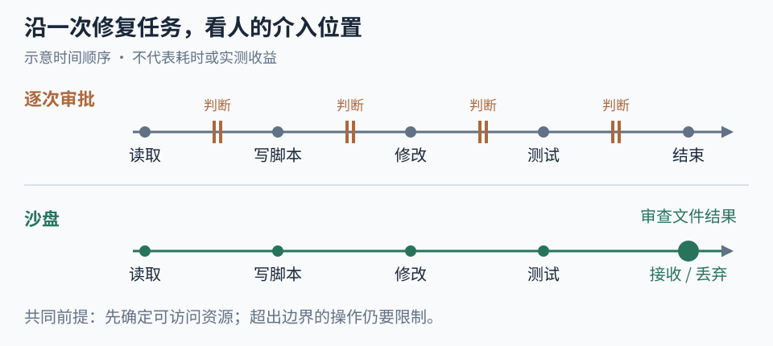{.stagebox-wide}

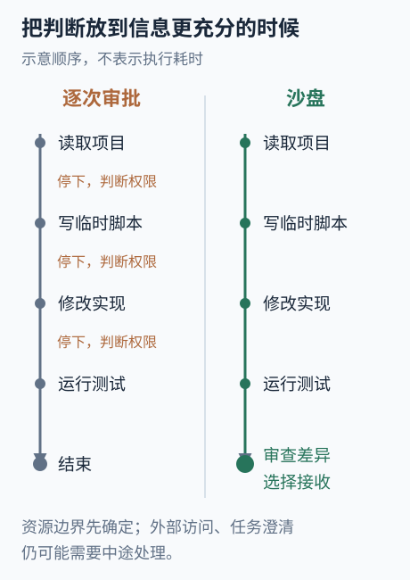{.stagebox-narrow}

<figcaption>图 2：一次任务里我们介入的位置。横轴只表示先后顺序，不表示耗时，也不表示已经测到的审批减少量；外部访问和任务澄清仍可能中途处理。</figcaption>
</figure>

检查不必堆到最后。多步任务的研究把确认、诊断和返工分开看：查得太密会打断，查得太晚，早期错误会把后面带偏。[^checkpoints] 短任务一次看完，长任务在阶段产物形成时停一下。

多 Agent 也可以照这个流程分工：子任务各持暂存，副作用不落到同一份工作区，各自交出候选，由接收方决定引入哪些。归属清楚了，权限委托、任务依赖和合并冲突仍留在上层。

拿一个很小的修复走一遍。`slugify` 只处理普通空格，碰到制表符和换行就出错；Agent 读到版本 A，修好、跑通测试，写出候选 C。这期间我们给同一个函数补了一行说明，原文件成了 B。直接收 C，说明就没了，要在 A、B、C 之间认出该留哪几处。

## 构建一个沙盘系统

### 隔离副作用：VM 还是容器 {#transparent-vm}

我们先要决定，Agent 跑在什么环境里。它执行一条命令，改变的不只是文件：进程会启动，挂载会变化，还会用到设备、内核状态和网络栈。容器可以限制这些访问，namespace 管能看到什么，cgroup 管能用多少资源，seccomp 管能调用哪些系统调用。但容器和宿主用的还是同一个内核；如果连这层也要隔开，就需要给任务一个独立内核。

多一个内核，就多一份启动和内存开销，还要给它准备能运行的文件系统。很多沙箱选择固定机器模型、镜像和恢复方式，把要处理的情况控制在有限的组合里。

我们希望保留独立内核，但准备环境这一步很烦。机器上已经装好了编译器和 Python，项目也就在手边；换成镜像重新定义环境，又得整理依赖、挂目录、配网络。还没开始验证 Agent 的修改，先把自己的机器重建了一遍。

所以 pVisor 把内核隔离和文件来源分开处理。Linux host-root 路径直接把宿主 `/` 作为只读 lower（基底），再叠一层私有 upper（可写层），通过 virtio-fs 把合成后的文件树交给 VM。Agent 用现成的程序和项目文件，运行中产生的修改进 upper，不用再准备一份系统盘镜像。

<figure class="stagebox-figure" markdown="1">

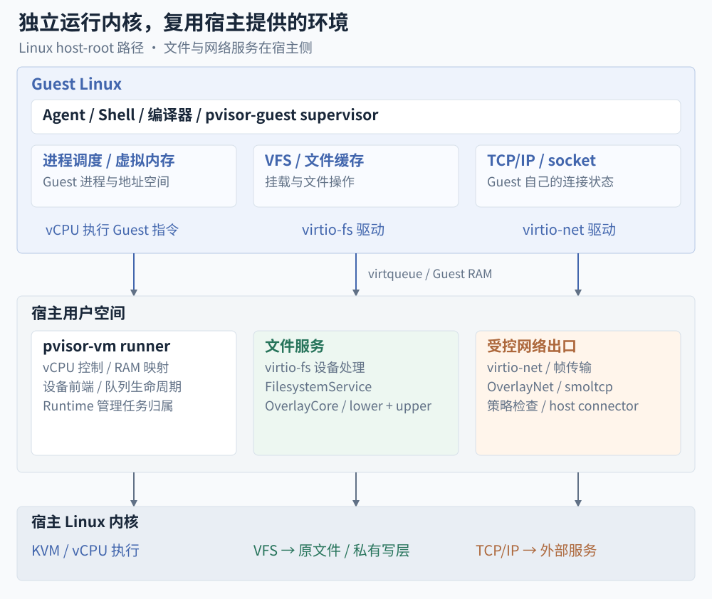{.stagebox-wide}

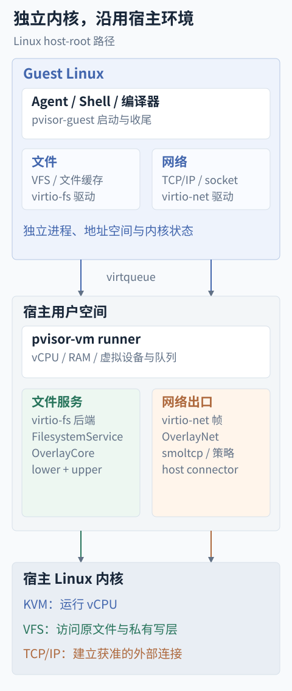{.stagebox-narrow}

<figcaption>图 3：Linux host-root 路径。Guest 保留独立内核，文件内容和外部连接由宿主服务提供。图中的文件设备由 pvisor-vm runner 处理，网络帧再交给宿主侧 OverlayNet。</figcaption>
</figure>

对程序来说，打开文件、起子进程、发连接的方式都没变，文件和网络由下层接到宿主，这就是我们说的“透明”。Guest 仍然管理自己的进程、内存、VFS 和 TCP/IP 状态，`/proc`、`/sys` 反映的也是 Guest。我们省掉的是另一套环境的准备和维护，两个内核里的进程和 socket 仍然各自独立。

具体到实现，`pvisor-vm` 在宿主 runner 里管理 vCPU、Guest RAM 和设备，Linux 上通过 KVM 运行 Guest。普通系统调用由 Guest 内核处理，需要后端服务的 I/O 才经过虚拟设备到宿主，不用把每条系统调用截下来交给宿主代跑。pVisor 通过 KVM 的 VM、内存和 vCPU 接口管理虚拟机，再接上文件暂存和网络出口策略。[^kvm]

这样省掉了预先复制整棵文件树、重新组装用户空间的工作，开销则留在 Guest 启动、RAM、缓存和 virtio 请求处理上。两个内核的页缓存仍然各存一份，I/O 也没有全部变成零拷贝。再算上暂存层的整文件 copy-up、原像哈希和持久化，到底省多少，得放进具体任务里量。

要跑这条 host-root 路径，宿主得有可用的 Linux 用户空间。当前 `pvisor stage` 先支持 Linux x86_64/KVM，macOS 上的程序和系统库不能直接拿来当 Linux rootfs；需要固定发行版或依赖版本的任务，也可以继续用镜像。暂存本身可以交给 Host 执行器：Linux 用 namespace、投影根目录和协商后的 Landlock 约束进程访问，macOS 用 Seatbelt。我们可以根据任务需要选择执行器，需要独立内核时再用 VM。

Agent 在 VM 里装了依赖，我们未必想把它也装回自己的机器。当前 `pvisor stage` 会保留整棵 rootfs 的 upper 和原像供审查，普通 `apply` 只接收启动时绑定的项目范围，项目外的修改继续留在 stage。系统写回另有受限入口，节点类型和恢复方式也与普通 workspace 暂存不同，见 [Linux stage 接口](https://github.com/DeepLink-org/pvisor/blob/main/crates/pvisor-cli/README.md#staged-system-experiments-linux-preview)。

沿用宿主环境，还得管好哪些文件可以给 Agent 看。live lower 会反映宿主后来的修改，HOME、凭据和项目 `.env` 都可能进入 Guest 的可读范围。我们需要限制导出路径，隐藏暂存区内部文件，也得防止任务从另一条宿主路径访问同一工作区，绕过自己的暂存视图。

### 隔离文件副作用：暂存、冲突与接收 {#file-view}

Agent 改文件，不一定会调用“写文件”工具。它可以用 Shell，也可以让编译器或子进程去写。只在 MCP 工具入口拦截，管不到这些修改；如果把写入一直压到批准之后，后面的测试又读不到新代码。所以我们把暂存放到文件访问路径上，让经过这套视图的读写都遵守同一套规则。MCP 负责工具入口，执行器限制访问范围，文件暂存和接收则由下层统一处理。

这部分文件服务放在 `pvisor-overlay-core` 里。Host 执行通过 FUSE 接入，VM 通过 virtio-fs 接入，两边共用文件合成、copy-up 和结果应用的逻辑，各自的适配器处理协议请求、文件句柄和平台权限。VM 传的是 FUSE 协议，宿主上不用先建一个 FUSE 合并挂载。

Agent 看到的目录由只读 lower 和私有 upper 合成。读文件先找 upper，没有再按优先级找 lower；第一次修改 lower 里的文件，系统先把它复制到 upper，后续都改这份私有副本。列目录时也要合并两边的内容，原文件和新建文件才能出现在同一个视图里。

<figure class="stagebox-figure" markdown="1">

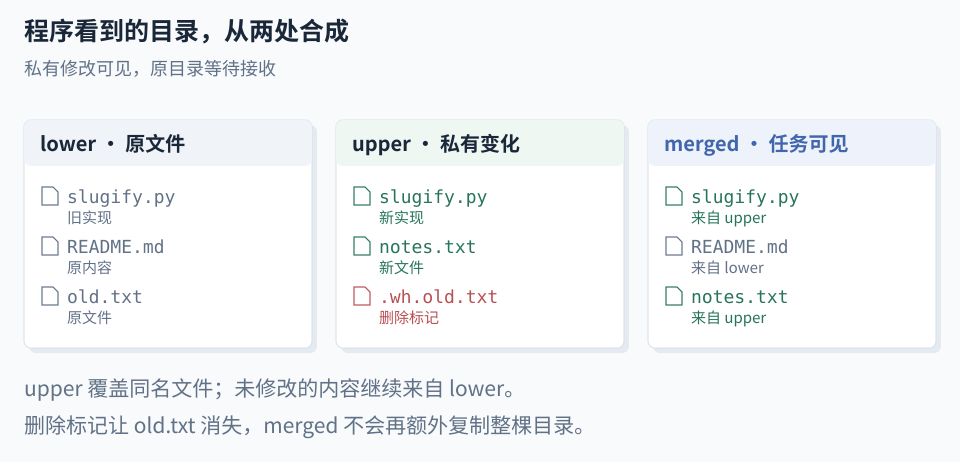{.stagebox-wide}

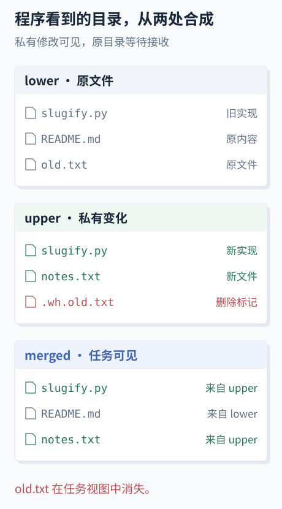{.stagebox-narrow}

<figcaption>图 4：同一目录在底层存储和任务视图中的样子。merged 是合成视图；upper 中的删除标记负责隐藏 lower 文件，不能只靠“不复制这个文件”表示删除。</figcaption>
</figure>

删除稍微麻烦一些：lower 里的原文件还在，只删 upper 中的副本，下次读又会看到旧内容。我们需要留下 whiteout（删除标记）把它遮住；整个目录被替换时，再用 opaque（目录遮盖标记）挡住旧目录的子项。重命名在审查清单里记成一次删除加一次新增。

目前普通文件按整文件 copy-up，改一个字节也可能复制整份文件。merged（合成视图）本身不再存一份副本；preimage（修改前记下的原像）只留冲突比较需要的指纹，不保存原文。这意味着当前还没有块级增量存储，也不能靠原像把任意修改原地回滚。

文件暂存下来以后，还得考虑我们自己也在改项目。Agent 先读到 A，我们随后把原文件改成 B，它又按照之前的 A 写出 C；接收时直接拿 C 覆盖，B 就丢了。记录基线的时间也很关键：如果等 Agent 第一次写入才记宿主状态，记下来的已经是 B。Apply 看见宿主仍然是 B，会以为没有冲突，接着用基于 A 生成的 C 把它盖掉。

<figure class="stagebox-figure" markdown="1">

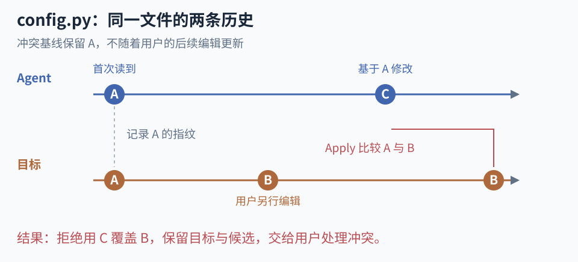{.stagebox-wide}

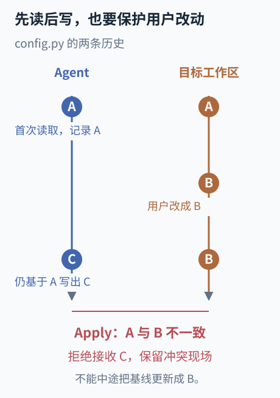{.stagebox-narrow}

<figcaption>图 5：原像必须留到 Apply。中途把基线换成 B，一次真实冲突就被藏掉了。</figcaption>
</figure>

所以在 live lower 下，pVisor 会在首次真正打开文件内容、读取相关 symlink 和 xattr 时记录原像；没有先读就修改的，在修改前记录。观察到路径确实不存在，也要记下来，否则我们后来创建的同名文件会被当成可以覆盖的新文件。普通成功的 stat 和目录列表不会为每个文件算内容哈希，免得列一次目录就要把里面的文件全读一遍。

记录什么，取决于节点类型：普通文件记录内容的 SHA-256、权限和所有权，目录记录自身元数据，符号链接记录链接目标。Apply 检查选中范围内的这些记录，发现目标变了就报冲突，两个版本怎么合并仍由我们或 Agent 处理。

这里还要分清 Agent 看到的文件和最后要覆盖的文件。lower 提供读取内容，apply target 是接收目标，baseline 对应的是接收目标的基线。假设额外 lower 里的配置是 B，目标工作区里是 A，Agent 读 B 写出了 C，接收时仍要检查目标 A 有没有变化。冻结布局从目标对应的 baseline 取原像，live 布局在运行时记录目标状态；只读基底如果是实时目录，任务读到的内容也会随之变化。

这套检查只覆盖本次要接收的修改。提交前再核对目标，思路接近乐观并发控制，但经典事务要检查受管事务之间的读写依赖，选择性 Apply 检查的是相应目标。[^occ] 没选中的无关只读路径不会挡住其他文件，因此它不提供完整读集上的串行化；需要整次任务的输入固定，就得准备不可变基线。

任务可能中途退出，机器也可能重启，暂存内容和审查记录都得留下来。`overlay.json` 保存布局、目标和状态，`preimages/` 保存原像日志、持久化策略和完成标记，`apply-ledger.json` 保存接收批次及进度。只把 upper 复制走，冲突基线和中断恢复需要的信息就丢了。

```text
stage/
├── overlay.json
├── upper/
├── work/
├── merged/
├── preimages/
└── apply-ledger.json
```

程序返回零退出码，也不代表文件已经写完。最近的写入可能还在 Guest 缓存、virtqueue 或宿主 worker 里，我们这时候看到的 upper 未必完整。Guest supervisor 要先同步可见的 virtio-fs 挂载，再报告退出；宿主完成收尾，确认写入者和设备不会继续修改，才同步并封存 stage。

<figure class="stagebox-figure" markdown="1">

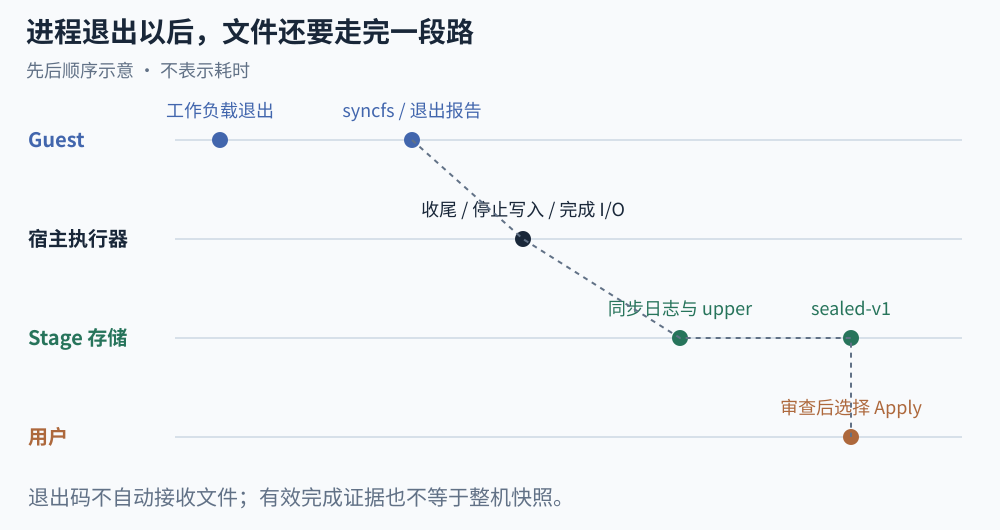{.stagebox-wide}

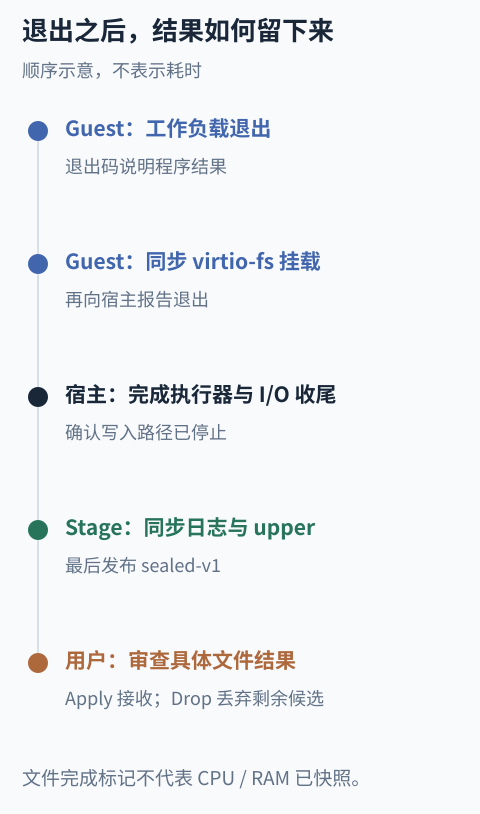{.stagebox-narrow}

<figcaption>图 6：退出码、文件完成和人工接收发生在不同位置。图示只描述顺序，不表示耗时；未形成有效完成证据的状态不能当作可接收结果。</figcaption>
</figure>

如果还要保存整机状态，顺序就更严格：先让 vCPU 停驻，排空设备请求，再关闭 RAM gate、等 lease 释放。CPU 停了，宿主 I/O 仍可能往 Guest 缓冲区里写；这时复制内存，就会混进不同时刻的状态。整机快照和文件 stage 的完成标记各自有完成条件，也都不能任意回滚 live host-root 或远端网络状态。

为了减少运行中的同步开销，受管理的 stage 默认采用 `checkpoint` 策略，原像写进 compact 帧日志。首次观察仍在内容暴露或修改前记录，但运行期间不为每个首次修改单独 fsync。任务结束后先停写入者，再同步原像日志、upper 文件和目录，最后发布 `sealed-v1` 完成标记。缺少这个标记，就不能把 stage 当作完整结果来 Apply，重新打开也一样。

默认策略把持久化集中在任务完成时，并拒绝接收没有持久化完整的状态。如果需要在首次修改前就同步日志，可以选 `--stage-durability strict`。程序显式调用 fsync 时，两种策略都会先同步观察记录，再同步数据。这个完成标记只管文件 stage；要恢复进程、内存和设备，还需要保存它们各自的状态。

Apply 本身也可能中断，所以接收过程需要单独记录。`apply_overlay_selected` 先拿目标锁，恢复未完成的批次，再确定选择范围、收集原像并检查冲突。我们可以用 `--path` 选文件或目录，也可以用 include/exclude 的 glob 筛选，但文件之间的依赖还得保留：硬链接组要一起处理，opaque 目录不能拆开，必要的新建父目录也要带上。

检查通过以后，Apply 先把这次准备接收什么写进账本，再更新目标。账本记录批次 ID、stage 的身份和 generation、选择路径、原像及状态。持久化时先写临时文件，fsync 后用 rename 整份替换，不逐行追加事件日志。

| 账本状态 | 此时已经发生什么 | 中断后如何继续 |
| --- | --- | --- |
| `Prepared` | 接收意图已持久化，目标可能尚未写入，也可能写入了一部分 | 检查原像或本批次预期结果，向前完成目标更新 |
| `TargetApplied` | 目标写入完成，暂存区可能还没清理完 | 完成 upper 裁剪及相关元数据处理 |
| `Committed` | 本批次完成，剩余候选已经确定 | 清理遗留备份，不重复覆盖目标 |

“目标已经写完”和“暂存区已经清理完”是两件事，所以我们单独记一个 `TargetApplied`。目标更新了，upper 可能只清掉一半；恢复程序需要知道接下来只做清理，避免拿残缺的候选再写一遍目标。

普通文件先写到目标旁的临时文件，同步后再 rename；破坏性的目录替换会保留一份与批次绑定的备份。恢复时仍要检查目标，它必须匹配原像或本批次的预期结果，不能因为上次中断就跳过。有 pending Apply 时，Drop 也会被拒绝，避免把恢复还要用的数据删掉。

目标锁只能协调遵守它的 pVisor 调用，外部编辑器仍可能在检查之后写入。所以 Apply 期间需要停掉其他目标写入者，这套流程还做不到对外部程序原子的多文件事务。Drop 可以丢掉剩余候选，已经接收的内容则要另行处理。

文件接回来以后，还得对最终组合跑一遍测试。两个文件没有冲突，程序行为也可能互相干扰；SafeMerge 研究的就是两边修改各自成立、合起来却引入新错误的情况。[^semantic-merge] 只接收几个文件，还可能把函数和调用方的修改拆开。整批候选当初通过了测试，不能代替对最终接收结果的验证。

实现可以从 [OverlayCore 的文件视图与冲突设计](https://deeplink-org.github.io/pvisor/zh/design/overlayfs/)、[stage 持久化](https://deeplink-org.github.io/pvisor/zh/design/isolation/#workspace-and-lifecycle)和[审查与应用](https://deeplink-org.github.io/pvisor/zh/guides/review-apply/)继续读；源码入口是 [core.rs](https://github.com/DeepLink-org/pvisor/blob/main/crates/pvisor-overlay-core/src/core.rs)、[stage.rs](https://github.com/DeepLink-org/pvisor/blob/main/crates/pvisor-overlay-core/src/stage.rs)、[preimage_log.rs](https://github.com/DeepLink-org/pvisor/blob/main/crates/pvisor-overlay-core/src/preimage_log.rs) 和 [apply.rs](https://github.com/DeepLink-org/pvisor/blob/main/crates/pvisor-overlay-core/src/apply.rs)。

### 隔离网络副作用：出口在宿主 {#vm-network}

文件写入可以留在 upper，网络请求一旦发出去，就到了真实服务。我们需要在建立外部连接之前检查权限，只设代理环境变量不够，不用代理的程序仍会尝试直连。所以 VM 把控制点放在虚拟网卡后面，出口的数据包统一经过宿主侧的 OverlayNet。

域名策略还有一个问题：应用查的是域名，发 SYN 时却只剩目标 IP。pVisor 为每次尝试保存合成 DNS 映射，用 `198.18.0.0/15` 里的地址代表对应名称，收到 SYN 后再还原目标，检查域名或 IP、端口、解析地址和本次任务的策略。授权通过、宿主连接也成功以后，Guest 侧的握手才继续；连接失败就返回失败。

当前这条数据面支持合成 DNS 和 IPv4 TCP，UDP、IPv6、QUIC 和普通入站连接尚未支持，会直接拒绝。`off` 让 VM 离线，`auto` 使用受控数据面。我们先把协议范围收窄，在这条路径上统一检查出口连接；Host/OCI 则通过显式代理接入，覆盖范围与 VM 不同。

<figure class="stagebox-figure" markdown="1">

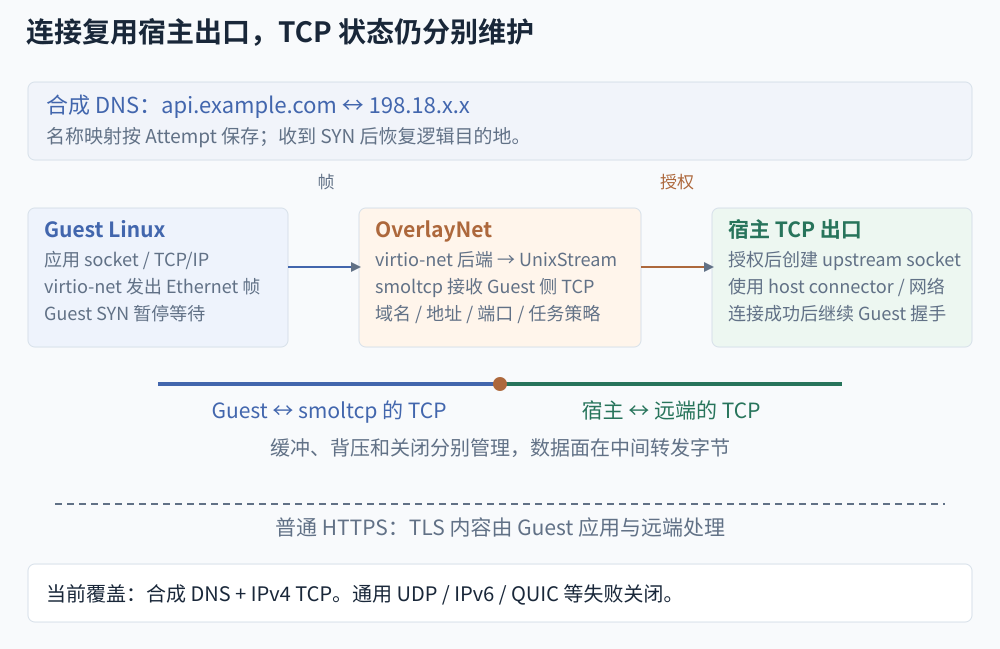{.stagebox-wide}

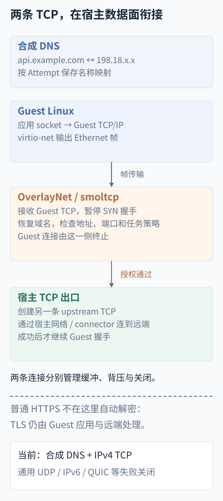{.stagebox-narrow}

<figcaption>图 7：两条 TCP 连接在宿主数据面衔接。示例域名只说明名称到合成地址的映射；普通 HTTPS 的 TLS 内容仍由应用与远端处理，不会因为经过 OverlayNet 就自动解密。</figcaption>
</figure>

连接建好以后，运行时还要处理两个方向的缓冲、背压、关闭和超时。任务取消可以关掉连接，远端已经收到的请求却追不回来。完整规则见 [OverlayNet 的 VM 网络路径](https://deeplink-org.github.io/pvisor/zh/design/overlaynet/#vm-request-path)。

这也决定了哪些判断必须留在执行前。敏感内容被读过，Drop 没法让 Agent 忘掉；邮件已经发出、数据库已经更新，丢掉工作区也撤不回。Externalization Barriers 讨论的就是这些外部影响：能缓冲的先缓冲，其余要靠外部系统提供暂定状态或补偿；如果下一步必须依赖不可逆调用的真实结果，我们就得当场决定。[^externalization]

远程写入超时就是一个常见例子。调用方不知道服务端做完没有，恢复 VM 再发一次，可能把同一个操作执行两遍。AWS 的幂等 API 用请求身份把重试关联回原来的结果，这个保证需要服务端配合，本地快照给不了。[^idempotency] 幂等可以避免重复执行，已经发出的内容仍然收不回来。

### 主动调度与内存节约 {#memory-sharing}

多个 Agent 各自保留一份执行环境，内存就成了另一笔开销。预热快照可以让多个 VM 映射同一份内存 backing，未修改的页继续共享，写入时才复制。host-root 下的任务各自启动，却也可能加载同一个 Python、同一组系统库，这些交集往往到运行时才出现。所以 pVisor 保留两条路径：已有共同基线的直接共享，运行后才发现相同的驻留页再做合并。[^pvisor-memory]

运行期合并要找的是已经出现在 RAM 里的相同内容。Linux 路径按 4 KiB 页扫描，两个 VM 可以从不同的启动状态出发，相同内容也可以出现在不同 GPA，只要验证内容一致，就有机会共用同一份物理页。

<figure class="stagebox-figure" markdown="1">

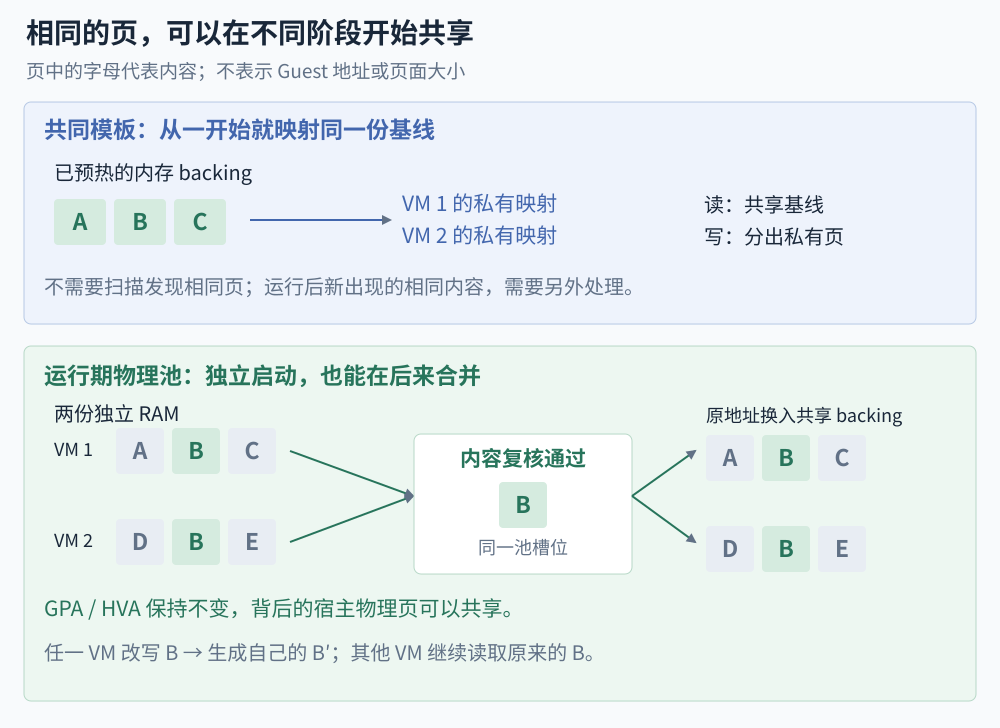{.stagebox-wide}

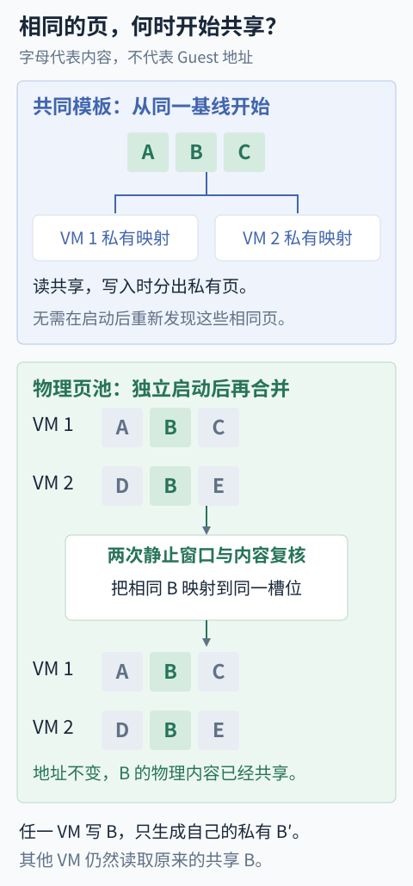{.stagebox-narrow}

<figcaption>图 8：示意页的颜色表示内容。上图从同一 backing 开始；下图先有两份独立内容，再经验证映射到同一槽位。两种路径都使用 CoW，差别在于何时、依据什么建立共享。</figcaption>
</figure>

麻烦在于，我们扫描的页还在被使用。刚算完哈希，Guest 就可能修改它，设备也可能往同一块缓冲区写；扫描时相同，换映射时未必还相同。pVisor 因此安排两次停驻：第一次停 vCPU、排空设备 lease，把候选页复制出来；恢复执行后，在停驻窗口之外查询或发布池对象；第二次再停 vCPU、排空设备 lease，逐字节核对 live RAM 和已经固定的池内容。中途变过的页就保留原样。

复核通过以后，才在原 HVA 上执行 `MAP_PRIVATE | MAP_FIXED`，把页面换成共享槽位的私有映射。Guest 地址和设备使用的宿主地址都不变，背后的物理页变成共享，写入时由 CoW 分离。旧槽位的引用要等映射替换完成才能释放；连接断开也不能直接当作 VM 已经退出，否则仍在运行的 VM 可能访问到被复用的槽位。[^pvisor-memory-code]

这样做要持续扫描、停驻和复核，比直接复用冻结模板贵。所有区域都按同一频率扫描也不划算：有些重复内容很快就变了，有些页一直独有，反复检查都没有收益。pVisor 按 Guest 物理区域分配预算，重复率高的多扫，频繁 CoW 或复核失败的少扫；只检查驻留页，避免为了去重把整片稀疏 RAM 读进来。[^uksm][^pvisor-memory-runtime]

文件读取还能给扫描提供一点线索。Linux virtio-fs 成功 READ 后，pVisor 会把刚读入的页列为优先检查的候选，思路与利用 I/O 提示缩小搜索范围的研究相近。[^ksm-hints] 但读完以后 Guest 随时可能修改缓冲区，安装共享映射前仍然要完整复核。

我们做过一组机制预检：四个独立 VM 各持一份相同的 64 MiB 随机内容，整组限四核、2 GiB、零 swap，每个条件只测一次。观察的是各组全部就绪以后，计费内存何时比各自的起点减少 128 MiB，并保持到 60 秒窗口结束。表中的时间是达到这个目标的采样区间。

| 模式 | 达到观测目标 | 60 秒计费内存 | 组 CPU 时间 |
| --- | --- | --- | --- |
| 关闭额外去重 | 未达到 | 398.91 MiB | 0.386 s |
| KSM | 27.723–27.773 s | 177.33 MiB | 0.384 s |
| 物理页池 | 1.688–1.739 s | 222.61 MiB | 5.924 s |

这次物理池在约 1.7 秒达到目标，KSM 在约 27 秒达到；到窗口结束时，KSM 的内存占用更低，组 CPU 时间也更少。KSM 还有 0.41 秒全局 ksmd CPU 时间没有计入组内，也不能全部归到这一组头上。换成各 VM 内容互不相同的条件，物理池花了 8.122 CPU 秒，内存只从 399.32 MiB 降到 391.62 MiB。没有足够的重复内容，主动扫描很难划算；这些单次预检还不足以比较稳定的性能高低。[^pvisor-memory-results]

所以我们没有用物理池替代其他机制。KSM 在宿主内核里合并相同匿名页，扫描预算由宿主管理员控制，pVisor 提供显式 advice 入口。[^ksm] 物理池让运行时自己选择候选、利用 I/O 提示、安排发布时机，相应的扫描 CPU、短暂停驻和槽位引用开销也由它承担。压缩处理难以共享但能压小的内容，offload 则把可以停驻的闲置状态卸载出去；这些机制的恢复路径和度量单位不同，节省比例不能直接相加。

当前物理池需要显式启用，与快照、offload、KSM 还有组合限制。共享也带来了依赖：物理池丢失，依赖它的 VM 就会失败，因此不能把它当持久检查点使用。[^pvisor-memory-runtime] 实际能省多少，要看重复页能留多久、写入有多频繁，以及扫描回本之前任务是不是已经结束了。

## Agent 沙箱的几条路线 {#microvm-tradeoffs}

把 pVisor 放到其他 Agent 沙箱旁边看，我们选择承担的工作会更清楚。大家遇到的问题不完全一样：环境怎么准备，执行状态怎么保存，空闲时怎么少占资源，以及最后怎么把结果交回来。不同项目把主要精力放在了不同位置。

### 别人先解决机器怎么来

NVX 先把机器模型收窄，只运行 x86-64 Linux Guest，直接启动内核，省掉固件和 PCI，vCPU 数量限定为 1、2、4、8。启动和恢复时要验证的组合因此少了很多，但也需要维护与之配套的内核和运行时。[^nvx-profile]

microsandbox 从 OCI 镜像起步，把环境准备放进开发者熟悉的镜像工作流；ArcBox 则把 Linux 机器放进 Mac 应用，Agent sandbox 再在里面启动 Firecracker。[^microsandbox][^arcbox-runtime]

smolvm 和 Zeroboot 更关心执行状态怎么复用。smolvm 可以从运行中的机器分出 CoW 子分支，Zeroboot 用预热模板加 `mmap(MAP_PRIVATE)` 创建新的 VM，让实例沿用已经初始化好的状态。[^smolvm-state][^zeroboot-architecture] Sandstorm 面对的是空闲环境占资源的问题，用 hot、frozen、snapshot、detached 四个状态逐步归还资源，再由请求触发唤醒。[^sandstorm-tiers]

| 项目 / 路径 | 优先解决的问题 | 为此承担的代价 |
| --- | --- | --- |
| microsandbox | OCI 工具体验与可嵌入的 microVM | 环境、卷和结果交付仍需工作流定义 |
| NVX | 固定机器合同与可校验的恢复 | 限制设备、架构与恢复组合 |
| smolvm | 执行分支、检查点和环境分发 | CoW 链、状态兼容与压平成本 |
| ArcBox Agent sandbox | 在 Mac 上提供独立 Linux 沙箱 | 嵌套虚拟化条件，项目与产物需要搬运 |
| Sandstorm | 空闲环境密度与按请求唤醒 | 存储和调度成本，尾延迟与容量上限 |
| Zeroboot | 预热模板的快速 fork | 单 vCPU、无网络，模板与恢复状态受限 |
| pVisor host-root Stagebox | 沿用当前环境，审查后接收修改 | live 输入、文件语义、冲突与恢复成本 |

这些环境里产生的修改，最后还要交出来。ArcBox 的 Agent 路径不挂宿主项目，`/workspace` 从空目录开始，产物通过文件 API 取回；[^arcbox-agent] microsandbox 的 owned volume 可以随快照分出私有副本。[^msb-volumes] 但我们恢复“测试通过的那个 VM”，拿到的仍然是那份候选；这期间自己还在改项目，候选怎么接回来，还需要配套的比较和合并流程。

看启动时间时也得注意它们量的是哪一段。microsandbox 报的是 M1 上的 Guest boot，首次创建可能还要拉镜像；Zeroboot 的 fork p50 是 0.79 ms，Python 的 fork + exec 约 8 ms，两个数字的终点就已经不同。它给出的每 fork 约 265 KB 内存，来自创建并持有一千个 VM、期间不运行 Guest 的实验。Sandstorm 则把请求排队、唤醒和被拒都算进测试里。[^microsandbox][^zeroboot-runtime][^zeroboot-bench][^sandstorm-results] 直接把这些数字排在一起，回答不了我们把一项任务跑完到底要多久。

<figure class="stagebox-figure" markdown="1">

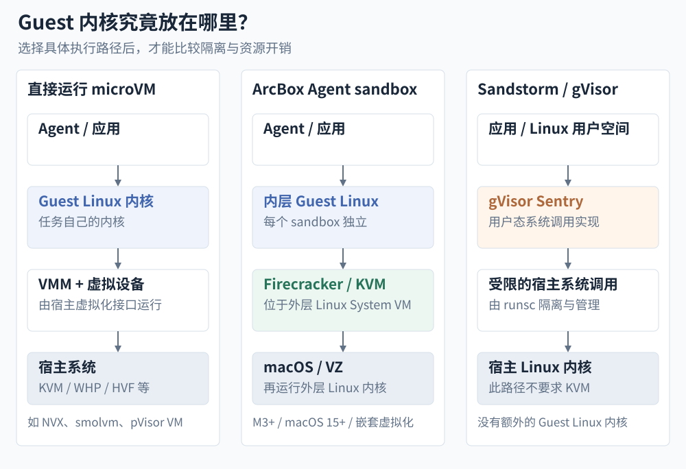{.stagebox-wide}

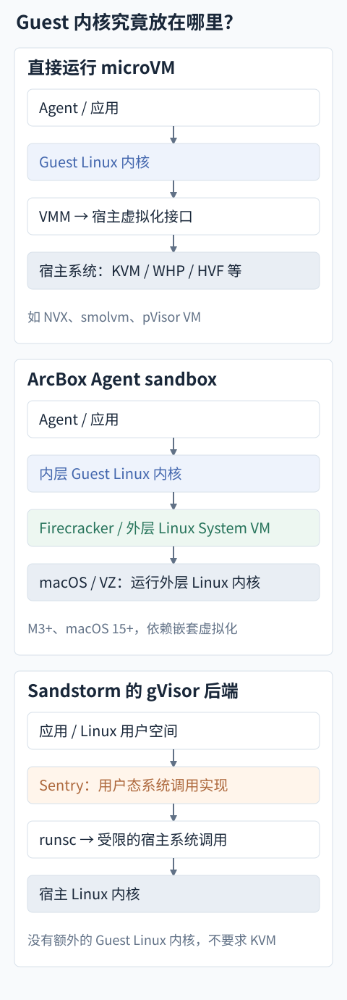{.stagebox-narrow}

<figcaption>图 9：按具体执行路径区分边界。Sandstorm 可以选择 gVisor 或 Firecracker；ArcBox 此处只画 Agent sandbox。图中省略控制服务和 I/O 设备，不代表各路径有相同开销。</figcaption>
</figure>

### 有人把粒度切到每次调用

LayerFS 把文件历史做到了每次调用。直接文件写操作可以形成一次原子提交；Bash 调用则可以临时挂载 workspace，运行后由编排器提交修改，再卸载。提交和卸载需要显式触发，workspace 也可以贯穿整个任务。[^layerfs] 没有变化就不新增提交；我们可以追到每行代码来自哪一步，也可以从任意提交分叉出新的尝试，fork 只改元数据，不复制文件。

这样一次任务会留下更细的文件检查点，方便逐步检查或回到先前版本。直接文件操作提交时遇到同文件冲突会被拒绝；workspace 的冲突则可能留下标记，修复后再提交。要把这套流程用到每个命令上，挂载就得足够轻，持续增长的文件历史也需要去重和压缩。暂存、冲突处理和交付都围绕同一套提交历史展开。

我们和它的区别，主要在接收目标。LayerFS 的修改提交到自己 Store 里的分支，共享和合并也在那里完成；pVisor 把现有项目留在宿主，旁边保留暂存层。任务完成时，我们要拿候选修改与仍在变化的宿主项目比较，再决定接收哪些。

### pVisor 押的是接收

我们选 host-root，更多是因为自己平时就这样干活：工具已经装好，项目里还有没提交的修改，有些问题只有在这台机器上才能复现。临时让 Agent 帮忙修一下，又得整理镜像、挑挂载目录、安排产物怎么带回来，准备本身就花了不少时间。沿用当前环境可以省掉这部分工作，接收结果的责任也就落到了运行时。

把项目交给 VM，常见的做法各有一个麻烦。只读挂载能保护源文件，Agent 却没法在原路径上修改后跑测试；可写挂载可以连续工作，修改又立刻落进原目录；复制一份出来能留住尝试，但与原项目的同步还要自己安排。Stagebox 把这一段接起来：读取已有环境，修改写进自己的 upper，结束后按文件检查和接收。

快照和 fork 可以保存执行状态，让我们从同一起点试不同方案。等到只想拿回其中两个文件时，还得核对当前项目有没有变化，以及这两个文件是否依赖其他修改；恢复整个分支不会替我们完成这一步。

接收这一步牵扯的实现不少。程序按原来的方式读写，文件服务就得保留重命名、硬链接和删除的语义；我们继续改原项目，首次读取时留下的原像就得跟着任务保存；Guest 退出后要等设备完成写入，Apply 中断后还得能继续。给 VM 接上共享目录，只解决了文件怎么访问，这些后续工作仍要有人处理。

沿用当前环境，首先要接受输入会变。镜像工作流固定 digest 以后，基础用户空间可以保持一致，再固定输入、约束外部依赖，任务比较容易重复。host-root 用 live lower，任务可能在不同时刻读到不同状态；原像检查能发现接收目标的变化，却不能把前面的读取变成一致快照。训练评测、批量 CI 这类需要固定输入的任务，用镜像或不可变基线更合适。

宿主目录里还有凭据、符号链接和其他访问路径，都得在导出时检查，避免把任务用不上的文件交给 Guest。只读能防止修改，秘密一旦进了可读范围，照样可能被读走。

| 要处理的问题 | 以镜像定义环境的工作流 | pVisor 的 live host-root 路径 |
| --- | --- | --- |
| 工具与依赖从哪里来 | 构建或选择镜像，声明额外挂载 | 复用宿主 Linux 用户空间，限制可读范围 |
| 如何重复一次任务 | 固定镜像与输入，继续约束外部服务 | 需另外冻结输入；live lower 本身不保证可复现 |
| 修改如何交付 | 由工作流选择产物导出、卷共享或代码合并 | 私有 upper、原像检查与选择性 Apply |
| 主要维护成本 | 镜像更新、环境配置与产物回收 | 文件语义、宿主访问边界、冲突与中断恢复 |

如果项目已经有成熟的 devcontainer、worktree 和 CI，环境准备和结果接收可能早就安排好了。host-root 能带来多少便利，要看每次交给 Agent 之前，我们还需要重复做多少准备。

### 一次修复，三种跑法 {#same-task-comparison}

回到前面的 `slugify` 修复。它只替换普通空格，遇到制表符和换行就出错；README 是我们没提交的草稿，不能动，Agent 过程中写的实验笔记也不算交付物。

修好并补充用例后，四项测试全过。我们要接收 `slugify.py` 和 `test_slugify.py`，README 草稿保留，实验笔记丢掉。如果这期间我们也改了原文件，事情就多一步：Agent 先读到 A，我们补上一句说明，文件变成 B；Agent 仍按 A 写出 C，修复有了，说明却没了。最后交付的 D，需要把两处修改都留下。

```python
def slugify(text):
    """Convert a blog title to a URL slug."""  # 用户补充的说明
    return "-".join(text.lower().split())       # Agent 的空白修复
```

Docker 如果直接把原项目 bind mount 进去，Agent 写文件就会改到原目录。先复制项目再挂副本，或者把源码放进容器可写层，才能保留独立候选，接收时再比较并合并。[^docker-runtime][^docker-storage] Git worktree 也能提供独立工作树，但它从提交或分支创建，不会自动带上当前目录未提交的修改，本例的 README 草稿就需要另外处理。[^git-worktree]

microsandbox 用 owned volume 可以保住私有候选，接回项目时仍要比较 B 和 C，把说明与修复合到一起。[^msb-volumes] pVisor 的 host-root 则直接使用宿主 Python：C 写进 upper，首次读取时留下 A 的原像；Apply 发现当前目标已经是 B，就拒绝覆盖。我们保留旧候选，基于 B 再跑一次修复，得到 D，再挑源码和测试接收。三种方案都能得到 D，区别在环境准备、基线保存和接收由谁完成。

<figure class="stagebox-figure" markdown="1">

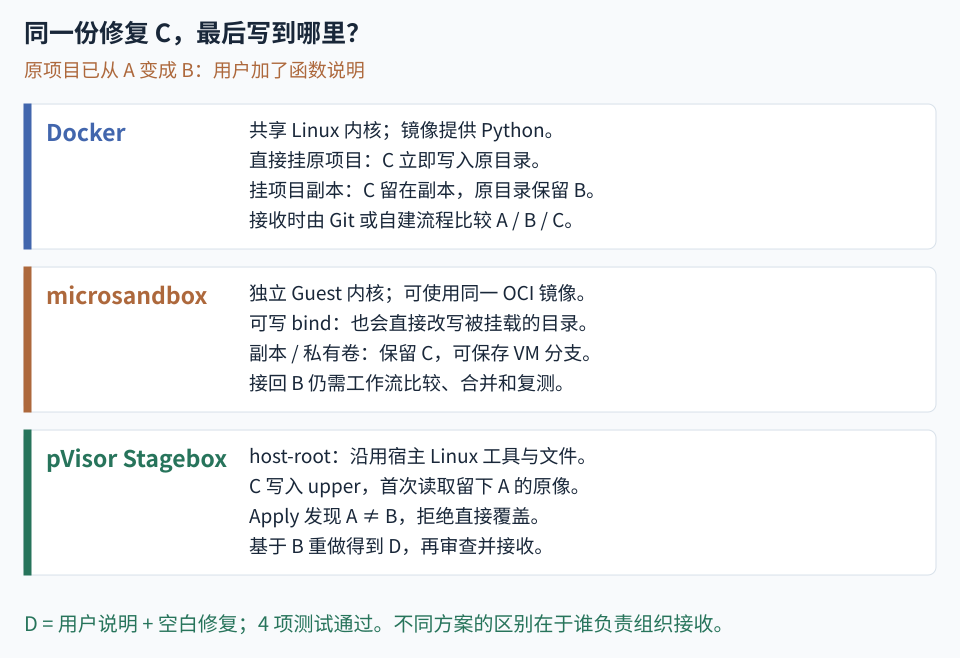{.stagebox-wide}

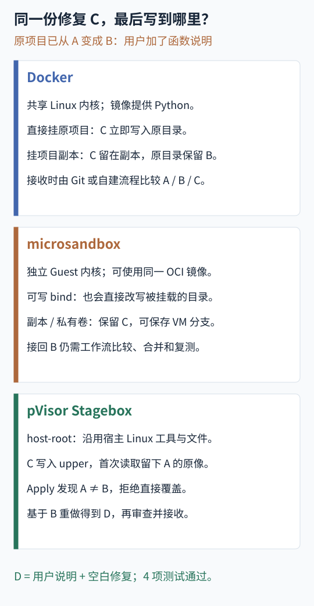{.stagebox-narrow}

<figcaption>图 10：三种方案都能得到 D。直写挂载会立即影响原目录；独立副本需要配套的比较与合并流程；Stagebox 将原像检查和选择性接收纳入运行时。</figcaption>
</figure>

这个任务可以离线运行：Docker 和 pVisor stage 用 `--network none`，microsandbox 用 `--no-net`[^msb-cli]。Docker 和 microsandbox 需要提前备好镜像，pVisor 的 host-root 路径使用宿主现有环境。

示例里的 Python 负载已经验证：初始 3 项测试中有 2 项失败，C 和 D 都是 4 项通过，D 保留了说明和 README。编写时的环境缺少 `/dev/kvm` 和 `/dev/fuse`，三种运行时尚未做端到端实测，命令按项目接口和官方文档核对。这个例子可以用来核对接收流程，实际省了多少审查时间，还得放进真实任务里测。

pVisor 目前还是开发者预览，接入时需要看对应客户端和平台的指南，Agent 或 IDE 的审批也不会自动关闭。我们希望省掉的是反复恢复上下文、预判影响的工作；如果中途弹窗少了，最后却甩来一份看不懂的大 diff，人的负担并没有减轻。

接下来我们想验证的是：保留原有测试和验收标准，用户能不能少花时间恢复上下文，同时仍然挑得出有问题的修改，把需要的结果带回项目。执行记录、文件差异和冲突检查，都要在这个过程中派上用场。

## 自己跑一次 {#_2}

完成[安装与 Host 暂存准备](https://deeplink-org.github.io/pvisor/start/installation/)后，可以先跑一个不需要模型账号的小例子：

```bash
mkdir pvisor-demo
cd pvisor-demo
pvisor spawn --safe --overlaynet-deny-all -- sh -c '
  echo "Hello from pVisor" > hello.txt
  echo "Temporary notes" > scratch.txt
'
pvisor review last --diff
pvisor apply last --path hello.txt
pvisor drop last
```

这里建两个候选文件，只接收 `hello.txt`，笔记丢掉。`last` 指当前工作区最近一次 Job，并行任务该写明确的 Job ID 或 stage 路径。普通 Host Job 默认直接写入，加 `--safe` 或 `--stage` 才启用工作区暂存；`--safe` 在必需控制装不上时会拒绝运行。

想跑前面的函数修复任务，可以继续看 [Claude Code 完整教程](https://deeplink-org.github.io/pvisor/guides/agents/claude-code/#repair-task)；[Codex 接入](https://deeplink-org.github.io/pvisor/guides/agents/codex/)和[项目源码](https://github.com/DeepLink-org/pvisor)也已公开。

## 附录：一次 read 怎么穿过两个内核 {#virtio-file-path}

一次文件读取怎么走到宿主，属于实现细节，跳过不影响结论。

以 VM 中一次未命中 Guest 页缓存的读取为例。应用调用 `read`，Guest VFS 按挂载关系找到 virtio-fs 驱动，驱动把 FUSE 请求放进 virtqueue，描述符指向 Guest RAM 里的请求和响应缓冲区，然后通知宿主设备实现。virtio-fs 本来就是让 Guest 挂载宿主导出目录的机制：协议用 FUSE，传输入口是虚拟设备，不是宿主 `/dev/fuse`。[^virtiofs]

<figure class="stagebox-figure" markdown="1">

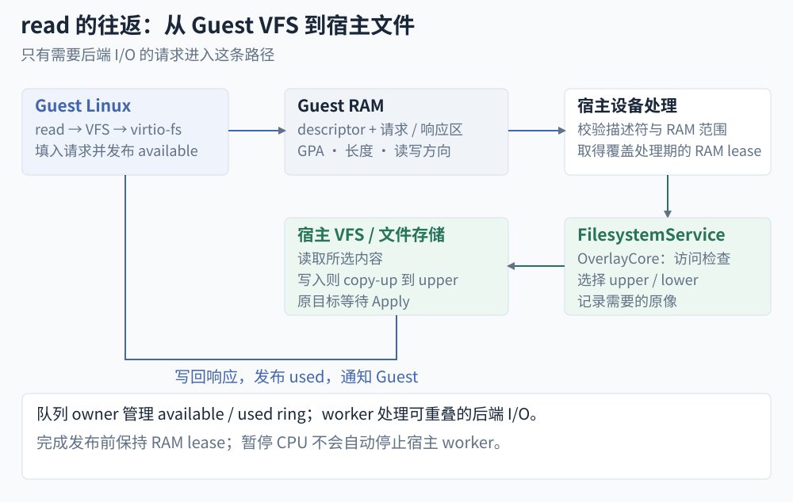{.stagebox-wide}

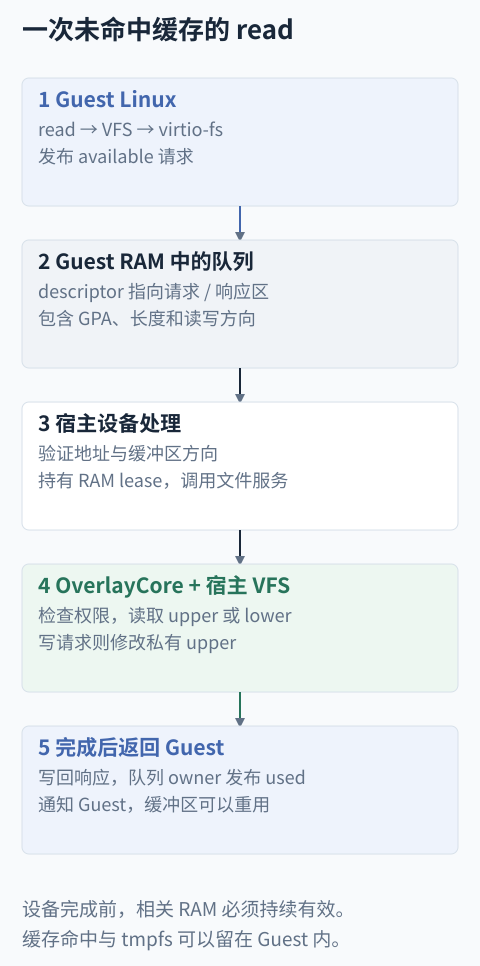{.stagebox-narrow}

<figcaption>图 11：需要后端 I/O 的读取路径。队列和缓冲区都在 Guest RAM；宿主校验地址和读写方向后才访问，完成时写回结果并发布 used 条目。Guest 缓存命中和 tmpfs 操作可以留在 Guest 内。</figcaption>
</figure>

宿主不能直接相信 Guest 给的地址。设备实现先检查 descriptor 的地址范围、长度和读写方向，确认落在允许的 Guest RAM 内，再调用共享文件服务。OverlayCore 挑 upper 或 lower，做访问检查和原像观察，最后由宿主文件接口取内容。响应写回 Guest 缓冲区后，队列 owner 发布 used 条目，Guest 才能结束这次请求、重用缓冲区。

写入走同一条设备路径，只是会触发 copy-up、私有写入或删除标记。编译器下次打开这个路径，就看到 upper 里的新内容。所以同一套暂存语义能覆盖编辑工具、Shell 和编译器，不必逐个理解它们的工具调用协议。范围仍限于这棵导出文件树，Guest 的 tmpfs、网络和其他设备各有各的状态。

当前 virtio-fs 用普通 request queue 和 hiprio queue。可重叠的大读取和目录读取交给有界 I/O worker，队列 owner 管 available/used ring；需要串行的修改在对应路径里保持顺序。设备处理期间持有 RAM lease，缓冲区从收请求到发布完成一直有效。这里要协调的是队列、文件 I/O 和内存映射的生命周期；单独暂停 vCPU，并不能保证宿主 worker 已经停止访问 Guest RAM。

## 参考文献 {#references}

[^sfi]: Robert Wahbe, Steven Lucco, Thomas E. Anderson, Susan L. Graham. [Efficient Software-Based Fault Isolation](https://doi.org/10.1145/168619.168635). SOSP, 1993. 此处仅用于说明软件隔离的技术历史早于云服务。

[^authbench]: Zheng Yan et al. [Do Coding Agents Understand Least-Privilege Authorization?](https://arxiv.org/html/2605.14859v2). arXiv:2605.14859v2, 2026，预印本。120 个任务分为 80 个标准任务与 40 个敏感任务；正文数据取自表 1 的标准任务集，生成策略均由固定 GPT-5 执行器运行。人工参考策略来自参考方案，不是所有可行执行路径的全集。

[^interruptions]: Jeffrey L. Jenkins, Bonnie Brinton Anderson, Anthony Vance, C. Brock Kirwan, David Eargle. [More Harm Than Good? How Messages That Interrupt Can Make Us Vulnerable](https://neurosecurity.net/media/Jenkins_et_al_ISR_2016.pdf). Information Systems Research, 2016. DOI: [10.1287/isre.2016.0644](https://doi.org/10.1287/isre.2016.0644)。此处引用实验 2 关于提示时机的结果；指标为提示未被回应的比例，不能等同于危险操作放行率。

[^autonomy]: Anthropic. [Measuring AI Agent Autonomy in Practice](https://www.anthropic.com/research/measuring-agent-autonomy). 2026-02-18. 第 3 节报告：新用户约 20% 的 session 完全自动批准，熟练用户超过 40%；主动中断从新用户约 5% 的 turn 增至熟练用户约 9%。两项指标分母不同。观察窗口为 2025 年末至 2026 年初，结论受到单一产品、用户自选择与默认设置等因素影响。

[^virtiofs]: Linux Kernel documentation. [virtiofs: virtio-fs host↔guest shared file system](https://docs.kernel.org/filesystems/virtiofs.html). 说明宿主导出目录、FUSE 协议与 virtqueue 的关系；pVisor 的适配器和暂存语义以项目实现为准。

[^kvm]: Linux Kernel documentation. [The Definitive KVM API Documentation](https://docs.kernel.org/virt/kvm/api.html). VM、vCPU、设备与内存接口。pVisor 的执行和冻结路径另见 [VM 子系统](https://deeplink-org.github.io/pvisor/zh/design/vm-runtime/)。

[^microsandbox]: microsandbox. [项目说明与 CLI / SDK 示例](https://github.com/superradcompany/microsandbox). OCI 镜像、执行生命周期、fork / snapshot、网络配置与启动时间口径。本文于 2026-11-01 核对 main 分支文档；功能与接口仍可能演进。

[^msb-volumes]: microsandbox. [Volumes](https://docs.microsandbox.dev/sandboxes/volumes). 宿主 bind mount 的读写语义，以及 owned volume 随快照和 fork 创建私有副本的行为；本地与云端的支持范围有所不同。

[^nvx-profile]: microsoft/nvx. [Machine Model and Configuration](https://github.com/microsoft/nvx/blob/48b046a2cd6146c2dbd55dd9a3ce3855ce8f576e/doc/design/2.1-machine-model-and-configuration.md)；[Non-Goals](https://github.com/microsoft/nvx/blob/48b046a2cd6146c2dbd55dd9a3ce3855ce8f576e/doc/design/1.2-non-goals.md)。

[^smolvm-state]: smol-machines/smolvm. [Branching](https://github.com/smol-machines/smolvm/blob/e9de2dab3614928fd984ff5e8c127af37fccbea0/docs/branching.md)；[Incremental Checkpoints](https://github.com/smol-machines/smolvm/blob/e9de2dab3614928fd984ff5e8c127af37fccbea0/docs/incremental-checkpoints.md)。

[^arcbox-runtime]: arcboxlabs/arcbox. [README](https://github.com/arcboxlabs/arcbox/blob/0903eb512d01678b24367b7511a6289064b78e8a/README.md)；[Sandbox gRPC API](https://github.com/arcboxlabs/arcbox/blob/0903eb512d01678b24367b7511a6289064b78e8a/docs/sandbox-api.md)。

[^arcbox-agent]: arcboxlabs/arcbox. [Coding Agents in a Sandbox](https://github.com/arcboxlabs/arcbox/blob/0903eb512d01678b24367b7511a6289064b78e8a/docs/agent-sandbox.md)。

[^sandstorm-tiers]: deeplethe/sandstorm. [ADR 3: Four Tiers](https://github.com/deeplethe/sandstorm/blob/3c3b2458df8fab03111b8ba553d576c5403c1c2c/docs/adr/0003-four-tiers.md)。

[^sandstorm-results]: deeplethe/sandstorm. [Latency on Three Hosts, 2026-10-31](https://github.com/deeplethe/sandstorm/blob/3c3b2458df8fab03111b8ba553d576c5403c1c2c/bench/fleet/results/2026-10-31/README.md)。 项目自测，所引 gVisor 配置为六个 2 核、2 GB 节点；流量测试与集中唤醒属于不同实验，本文未复测。

[^zeroboot-architecture]: zerobootdev/zeroboot. [Architecture](https://github.com/zerobootdev/zeroboot/blob/d97720e32e320d37b04e268fdfb53bbaf8a8366f/docs/ARCHITECTURE.md)。

[^zeroboot-runtime]: zerobootdev/zeroboot. [README](https://github.com/zerobootdev/zeroboot/blob/d97720e32e320d37b04e268fdfb53bbaf8a8366f/README.md)。

[^zeroboot-bench]: zerobootdev/zeroboot. [Fork Benchmark Implementation](https://github.com/zerobootdev/zeroboot/blob/d97720e32e320d37b04e268fdfb53bbaf8a8366f/src/main.rs)。 将 fork、fork 后执行与多个 VM 并存分开测量；Phase 4 串行创建并持有 VM，再用进程 RSS 除以数量，未运行 Guest 负载。

[^pvisor-memory]: pVisor. [内存子系统](https://github.com/DeepLink-org/pvisor/blob/482d7b2563bf2a1538539da3ff91a10a6153b367/docs/src/zh/design/memory-optimization/index.md)、[内存去重](https://github.com/DeepLink-org/pvisor/blob/482d7b2563bf2a1538539da3ff91a10a6153b367/docs/src/zh/design/memory-optimization/deduplication.md)。区分共同基线、物理页池、KSM、压缩和 offload 的对象与生命周期。

[^pvisor-memory-runtime]: pVisor. [VM 实现与平台限制](https://github.com/DeepLink-org/pvisor/blob/482d7b2563bf2a1538539da3ff91a10a6153b367/crates/pvisor-vm/README.md)、[公开 API 合同](https://github.com/DeepLink-org/pvisor/blob/482d7b2563bf2a1538539da3ff91a10a6153b367/crates/pvisor-vm/src/api.rs)。共同内核基底、显式不可变 DAX、Linux 文件提示、Apple Silicon 16 KiB 页合并及组合限制。

[^pvisor-memory-code]: pVisor. [Linux 页采样、复核与映射替换](https://github.com/DeepLink-org/pvisor/blob/482d7b2563bf2a1538539da3ff91a10a6153b367/crates/pvisor-vm/src/cold_ram_linux.rs)、[设备 RAM gate](https://github.com/DeepLink-org/pvisor/blob/482d7b2563bf2a1538539da3ff91a10a6153b367/crates/pvisor-vm/src/devices/virtio/memory_gate.rs)。`sample_candidates`、`commit` 与两次 `ram_quiesced` 调用定义运行期共享的安全边界。

[^pvisor-memory-results]: pVisor. [内存去重曲线与机制预检](https://github.com/DeepLink-org/pvisor/blob/482d7b2563bf2a1538539da3ff91a10a6153b367/docs/src/zh/lab-notes/vm-memory-performance-analysis.md)、[实验协议与证据范围](https://github.com/DeepLink-org/pvisor/blob/482d7b2563bf2a1538539da3ff91a10a6153b367/benchmark/memory/README.md#published-curves-and-archived-history)。2026-10-18 的完整预检，每条件 N=1；本文引用已有记录，未重新运行。原始本地归档未随仓库发布，不能视为已经独立复现。

[^docker-storage]: Docker. [Bind mounts](https://docs.docker.com/engine/storage/bind-mounts/)、[Storage](https://docs.docker.com/engine/storage/) 与 [docker container cp](https://docs.docker.com/reference/cli/docker/container/cp/)。bind mount 直接连接宿主路径，独立于容器可写层；文件导出提供复制能力，项目基线比较与源码合并仍由工作流组织。

[^docker-runtime]: Docker. [Docker Engine security](https://docs.docker.com/engine/security/) 与 [None network driver](https://docs.docker.com/engine/network/drivers/none/)。本文比较普通 Linux Engine 容器的内核与网络隔离，不把 Docker Desktop 的外层 VM 或其他可选运行时混入同一配置。

[^git-worktree]: Git. [git-worktree](https://git-scm.com/docs/git-worktree)。worktree 从分支或提交创建独立工作树；当前工作目录未提交的内容需要另行纳入输入。

[^msb-cli]: microsandbox. [Sandbox commands](https://docs.microsandbox.dev/cli/sandbox-commands)。本地 CLI 的镜像、挂载、工作目录、网络关闭及命名沙箱生命周期。示例按 2026-11-01 的 main 分支文档编写，实际安装版本需对应核对。

[^outcome-alignment]: [Instructions Are Evidence, Not Objectives: Measuring Outcome Alignment of Agents](https://arxiv.org/html/2610.17757v1). 2026，预印本。附录 B 随机抽取 100 条 SWE-chat 轨迹，两阶段人工标注发现 56 条初始要求不完整；后续要求的可推断性允许使用当时已出现的执行反馈。需求完整性与授权合法性是不同问题，模型推断不能代替用户授权。

[^review-bandwidth]: [AI Writes Faster Than Humans Can Review: A Longitudinal Study of an Enterprise “2×” Mandate](https://arxiv.org/html/2607.01904v1). 2026，预印本。完整面板含 802 名开发者、196,212 个非 bot PR；正文趋势取自至少有 3 个活跃月的 564 人分析样本，时间为 2025 年初至 2026 年 4 月；同期人工审查覆盖约 89%→68%。单企业、非随机观察；无评论批准不等于没有认真阅读，PR 负载不等于实际审查耗时，人工与自动审查覆盖也可重叠。

[^approval-study]: Anthropic. [Auto mode is now the default in Claude Code](https://claude.com/resources/articles/auto-mode-default-in-claude-code). 2026。1,053 名付费专业测试者在受控环境中遇到被替换的危险权限提示；危险命令不实际执行。人工拦截 143 次，自动模式拦截 937 次，其中 800 次仅自动模式拦截，据此得到图 1 四格计数。厂商主导的实验，不是生产事故率，也未比较 Stagebox 的结果审查。

[^permission-policy]: [Do User-Authored Permission Policies Improve Protection Against AI Agent Overreach?](https://arxiv.org/html/2608.27443v1). 2026，预印本。113 名非软件背景参与者、18 个预设动作的短时模拟，无真实账户和实时 LLM 决策。初始随机样本 94 人，后补充 19 名策略组参与者。提示数 18 与 10.9 为描述性均值；策略组相对逐次确认的调整后总干预时间差为 −12.9 秒，95% CI [−46.3, 20.6]，越权阻断率差为 −20.1 个百分点，95% CI [−32.1, −8.1]。不能据此否定所有权限规则。

[^isolated-commit]: [Alcatraz: An Isolated Environment for Experimenting with Untrusted Software](https://www.seclab.cs.sunysb.edu/seclab/pubs/tissec09.pdf). ACM TISSEC, 2009；[TxBox: Building Secure, Efficient Sandboxes with System Transactions](https://www.cs.columbia.edu/~suman/docs/oakland11-txbox.pdf). IEEE S&P, 2011。前者隔离写入并检查后接收，后者依赖 TxOS 的内核事务。其提交保证不能直接套用于 pVisor 的逐路径 Apply，已发生的远程 I/O 也不随本地状态自动撤销。

[^try]: [Controlling Opaque-Component Effects with Semisolates and Try](https://www.usenix.org/conference/osdi26/presentation/lamprou). OSDI, 2026。Linux namespace 与 OverlayFS 保留文件效果，再检查和选择应用。网络效果不自动事务化，选择性接收仍可能拆开依赖；不等同于对任意恶意程序的完整安全保证。

[^yolofs]: [Don’t Let AI Agents YOLO Your Files: Information and Control in Agent-Native Filesystems](https://arxiv.org/html/2604.13536v5). SOSP, 2026，本文使用 v5。Linux 内核文件系统原型，提供版本、审查和提交。112 个单操作任务中的平均提示量由 0.9 降至 0.4，但由自动 driver 回复，没有真人总审查时间实验；跨会话冲突整合留给其他系统，文件回退不回退进程和网络。

[^checkpoints]: [When Should Users Check? Modeling Confirmation Frequency in Multi-Step Agentic AI Tasks](https://arxiv.org/html/2510.05307v4). CHI, 2026；本文核对作者 v4。48 人模拟任务使用预设错误与固定执行时长，39 人偏好中间检查点。这里采用检查、诊断和返工的分析方法，不把总任务时间写成人工审查时间，也不外推至真实编码 Agent 的收益。

[^occ]: H. T. Kung, John T. Robinson. [On Optimistic Methods for Concurrency Control](https://www.eecs.harvard.edu/~htk/publication/1981-tods-kung-robinson.pdf). ACM TODS, 1981。受管事务的读、验证与写阶段，以及串行化条件；用于说明提交前验证的来源，不为 pVisor 的选择性文件接收提供事务保证。

[^semantic-merge]: Marcelo Sousa, Isil Dillig, Shuvendu K. Lahiri. [Verified Three-Way Program Merge](https://www.cs.utexas.edu/~isil/verified-merge.pdf). OOPSLA, 2018。SafeMerge 针对 Java 方法验证语义冲突；单过程分析假定外部调用无冲突，并发、终止与异常处理均有范围限制。它说明文本冲突与行为正确性有区别，不表示 pVisor 已实现此类验证。

[^externalization]: [Externalization Barriers: An OS Abstraction for Untrusted Agent Exploration](https://os-for-agent.github.io/papers/AgenticOS_SOSP_2026_paper_19.pdf). AgenticOS, 2026。三页立场论文，讨论缓冲、暂定可见和补偿等外部效果；没有完整实现与效果评测。撤销可能留下通知、审计等外部痕迹。

[^idempotency]: AWS Builders’ Library. [Making retries safe with idempotent APIs](https://aws.amazon.com/builders-library/making-retries-safe-with-idempotent-APIs/). 调用者请求 ID、重复请求与迟到请求的服务端处理；记录请求身份与业务变更需要满足服务端原子性要求。幂等防止部分重复执行，不能消除原始动作发生过的事实。

[^ksm]: Linux Kernel documentation. [Kernel Samepage Merging](https://docs.kernel.org/admin-guide/mm/ksm.html)。匿名页扫描、`MADV_MERGEABLE`、CoW 和全局扫描器的职责。

[^layerfs]: LayerFS. [Ephemeral Workspaces, Durable Shared History](https://layerfs.ai/) 与 [Core ideas](https://layerfs.ai/docs/core-ideas/)。2026-11-01 访问。直接文件写操作形成原子提交；Bash 工作区由编排器显式提交和卸载，也可贯穿整个任务，无变化不新增提交。直接文件操作与 workspace 的冲突处理不同，后者可留下冲突标记供修复后再次提交。分支与 fork 只改元数据，存储侧提供内容去重与压缩。页面上挂载与依赖安装耗时的对照是说明性数字，本文未复测。

[^uksm]: [UKSM: Swift Memory Deduplication via Hierarchical and Adaptive Memory Region Distilling](https://www.usenix.org/conference/fast18/presentation/xia). FAST, 2018。区域分层与扫描预算自适应。pVisor 按 Guest 物理区域组织自己的用户态实现，并非移植 UKSM 的应用 VMA 或部分页哈希机制；论文性能数字不代表 pVisor。

[^ksm-hints]: [KSM++: Using I/O-based hints to make memory-deduplication scanners more efficient](https://publikationen.bibliothek.kit.edu/1000048144). REsoLVE, 2012。修改宿主内核的 I/O 路径，为 KSM 生成候选提示，并与普通扫描交替。pVisor 的 virtio-fs READ 提示产生于自己的设备路径；二者都不能只凭提示判定内容相同。
